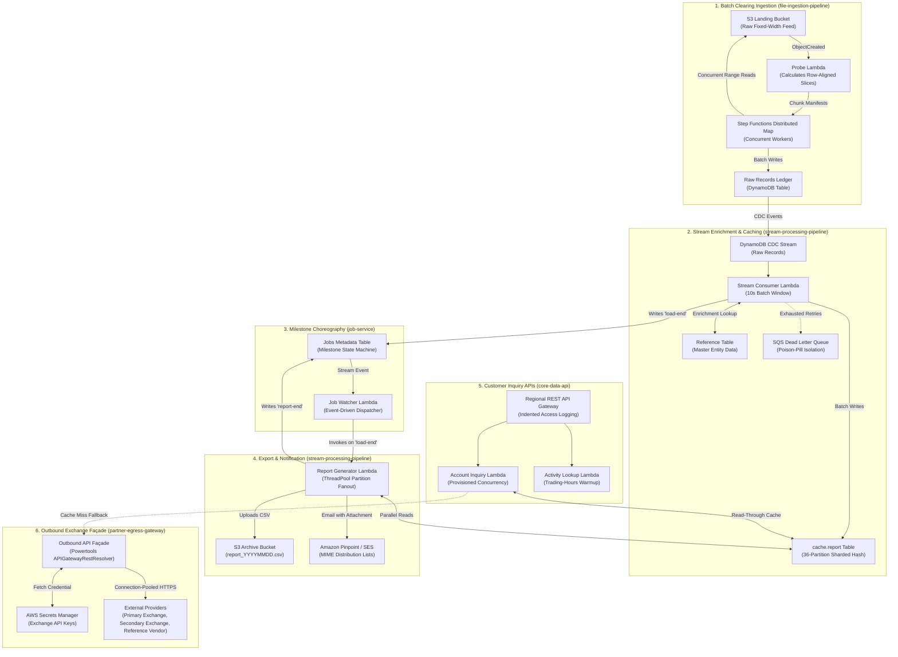

# Enterprise Serverless Clearing & Market Data Platform

> **Architecture Overview & Repository Monorepo Guide**:  
> In production enterprise environments, these subsystems deploy independently via decoupled CI/CD pipelines to prevent blast-radius escalation and CloudFormation resource-limit exhaustion (500 resources).  
> **To provide a cohesive, end-to-end evaluation experience, they are assembled here into a unified platform monorepo.** Every subdirectory represents an independently deployable microservice or shared platform component with its own SAM template, test suite, and operational contracts.
> 
> *Architecture Specification*: Reference implementation of a decoupled microservice platform, separating public-facing ingress points from internal clearing and stream enrichment workflows.

---

## Quick Navigation

- [1. System Topology & Operational Flow](#1-system-topology--operational-flow)
- [2. Subsystems & Architecture Taxonomy](#2-subsystems--architecture-taxonomy)
- [3. Real-World Constraints & Tradeoff Engineering](#3-real-world-constraints--tradeoff-engineering)
  - [A. Batch Windowing vs. Invocation Backpressure](#a-batch-windowing-vs-invocation-backpressure)
  - [B. Row-Boundary Byte Snapping (Zero Record Splitting)](#b-row-boundary-byte-snapping-zero-record-splitting)
  - [C. Read/Write Latency Targets & Read-Through Fallback](#c-readwrite-latency-targets--read-through-fallback)
  - [D. Poison-Pill Isolation & Partial Batch Failures](#d-poison-pill-isolation--partial-batch-failures)
  - [E. Concurrency Strategy: Cost vs. Latency Optimization](#e-concurrency-strategy-cost-vs-latency-optimization)
  - [F. Two-Phase Financial Reconciliation & Tolerance Balancing](#f-two-phase-financial-reconciliation--tolerance-balancing)
  - [G. Self-Healing Secret Rotation in Egress Gateway](#g-self-healing-secret-rotation-in-egress-gateway)
- [4. Cross-Stack Dependency & Deployment Order](#4-cross-stack-dependency--deployment-order)
- [5. Global Test Execution](#5-global-test-execution)
- [6. Local Pipeline Simulation & Feed Generator](#6-local-pipeline-simulation--feed-generator)

---

## 1. System Topology & Operational Flow

This platform serves as the **high-throughput clearing ingestion, real-time CDC enrichment, automated reporting, and external exchange egress engine** for institutional brokerage operations.



---

## 2. Subsystems & Architecture Taxonomy

Subsystems are partitioned into decoupled, single-responsibility domains:

| Subsystem | Architectural Domain | Core Architectural Strategy | Service Boundary & Patterns |
|---|---|---|---|
| [**`core-data-api/`**](./core-data-api/README.md) | Inbound Account & Activity APIs | Read-through caching with tiered concurrency (Provisioned + Auto-scaling) | Synchronous REST API (API Gateway + Warm Lambda) |
| [**`file-ingestion-pipeline/`**](./file-ingestion-pipeline/README.md) | High-Volume Batch Feed Ingestion | Mathematical byte-range snapping & zero-split parallel range reads | S3 Event-Driven Distributed Map (Step Functions) |
| [**`job-service/`**](./job-service/README.md) | Milestone Choreography & Coordination | Asynchronous DynamoDB Streams milestone triggers (`load-end` $\rightarrow$ `report-end`) | DynamoDB Streams Orchestration Service |
| [**`partner-egress-gateway/`**](./partner-egress-gateway/README.md) | Outbound Financial Market Data Façade | Singleton connection pooling with self-healing credential rotation retry | Outbound Proxy with Secret Rotation & Fallback |
| [**`stream-processing-pipeline/`**](./stream-processing-pipeline/README.md) | Real-Time Stream Enrichment & Reporting | Micro-batch CDC buffering (10s) with 36-partition sharded hash cache | CDC Sharded Consumer, Multi-threaded Reporter & Pinpoint |
| [**`shared-infra/`**](./shared-infra/README.md) | Account-Level Storage & Governance | Enforces TLS 1.3 transport, Glacier lifecycle transitions, and PITR backup | Core CloudFormation Foundation & Encryption Primitives |
| [**`shared-utils/`**](./shared-utils/README.md) | CloudFormation Automation Custom Resources | Zero-downtime dynamic Stream ARN discovery and non-empty bucket teardown | Shared Infrastructure Automation Framework |
| [**`lambda-infra-layer/`**](./lambda-infra-layer/README.md) | Centralized Dependency Packaging | Automated ARM64 wheel packaging (`crhelper`, `pandas`, `openpyxl`) | Cross-Service Binary & Library Distribution Layers |

---

## 3. Real-World Constraints & Tradeoff Engineering

### A. Batch Windowing vs. Invocation Backpressure
- **The Constraint**: Real-time DynamoDB CDC stream events arrive in bursty waves (thousands of events/sec during market close, followed by quiet periods).
- **The Tradeoff**: Invoking Lambda immediately on every stream shard triggers thousands of tiny invocations, driving up compute bills and throttling downstream reference table reads.
- **Production Choice**: Configured `MaximumBatchingWindowInSeconds: 10` alongside `BatchSize: 100` and `BisectBatchOnFunctionError: true` in [`stream-processing-pipeline/template.yaml`](./stream-processing-pipeline/template.yaml). The 10-second buffer smooths micro-bursts, maximizes DynamoDB batch write efficiency (25 items/request), and cuts Lambda invocation volume by over 70%.

### B. Row-Boundary Byte Snapping (Zero Record Splitting)
- **The Constraint**: A 50 GB fixed-width flat file cannot be loaded into memory or downloaded to a Lambda `/tmp` drive (512 MB – 10 GB limit). Slicing naively by arbitrary byte offsets splits multi-byte records in half, producing corrupted accounting ledgers.
- **The Tradeoff**: Streaming the file line-by-line through a master worker creates a single point of failure and takes hours.
- **Production Choice**: Designed the **Probe Pattern** in [`file-ingestion-pipeline/src/probe_service.py`](./file-ingestion-pipeline/src/probe_service.py). The probe reads only the first 2,048 bytes to detect the line delimiter (`\n` or `\r\n`) and compute row byte length $L$. It then mathematically snaps arbitrary chunk intervals to row multiples:
  $$\text{EndByte} = \min\left(\left\lfloor \frac{\text{RawEnd} + 1}{L} \right\rfloor \times L - 1, \; \text{TotalSize} - 1\right)$$
  ```python
  # Row-boundary snap implementation (src/probe_service.py)
  end_byte = min(((raw_end + 1) // row_length) * row_length - 1, total_size - 1)
  ```
  Workers in [`file-ingestion-pipeline/src/worker_service.py`](./file-ingestion-pipeline/src/worker_service.py) then perform concurrent HTTP Range Reads (`bytes=start-end`), guaranteeing zero split rows with zero inter-worker coordination.

### C. Read/Write Latency Targets & Read-Through Fallback
- **The Constraint**: Institutional customer portals require account inquiry response times under 50ms (p99 < 100ms). Third-party external exchange APIs frequently exhibit p99 latencies of 800ms–2,500ms.
- **The Tradeoff**: Synchronously proxying every customer request to external vendors destroys user SLA and exposes internal systems to external outages.
- **Production Choice**: Designed a **multi-tier read-through cache strategy** across [`core-data-api`](./core-data-api/README.md) and [`partner-egress-gateway`](./partner-egress-gateway/README.md):
  1. Primary read hits DynamoDB Cache Table (`ConsistentRead=False`, <8ms latency) via [`core-data-api/src/account_service.py`](./core-data-api/src/account_service.py).
  2. On cache miss, requests fail over asynchronously to [`partner-egress-gateway`](./partner-egress-gateway/README.md), which queries external exchanges using connection-pooled HTTPS sessions.
  3. If external vendors time out or return 5XX, the API degrades gracefully, returning cached ledger summaries with a non-blocking diagnostic warning.

### D. Poison-Pill Isolation & Partial Batch Failures
- **The Constraint**: In stream processing, an unhandled exception on a single malformed record causes AWS to retry the entire shard batch indefinitely, blocking all subsequent customer records (head-of-line blocking).
- **The Tradeoff**: Swallowing all errors silently leads to silent data loss and out-of-balance clearing ledgers.
- **Production Choice**: Implemented `ReportBatchItemFailures` in [`stream-processing-pipeline/src/load_consumer_service.py`](./stream-processing-pipeline/src/load_consumer_service.py) and an encrypted SQS Dead Letter Queue in [`stream-processing-pipeline/template.yaml`](./stream-processing-pipeline/template.yaml):
  - Malformed records that fail deserialization are captured, and their specific `sequence_number` is returned in `batchItemFailures`.
  - AWS retries strictly the failed records up to `MaximumRetryAttempts: 3`.
  - Once exhausted, records are routed to the DLQ (`StreamProcessingDLQ`), unblocking the shard while firing a P1 CloudWatch alarm for operational remediation.

### E. Concurrency Strategy: Cost vs. Latency Optimization
To balance 24/7 AWS compute cost against strict market-open latency SLAs, the architecture formalizes compute into three distinct operational profiles:

| Pattern | Mechanism | Cost Profile | Target Workload |
|---|---|---|---|
| **Pattern 1: The Cheap Way** | EventBridge Warmup Cron (Mon-Fri 8am-4pm EST) | **\$ (Fractions of a cent/month)** | Non-critical back-office lookup endpoints ([`activity_service`](./core-data-api/src/activity_service.py), [`pages_service`](./core-data-api/src/pages_service.py)). Intercepts keep-alive pings in <1ms without touching DynamoDB. |
| **Pattern 2: The Critical Way** | Fixed Provisioned Concurrency 24/7 | **\$\$\$ (High)** | Mission-critical trade execution paths where cold-starts (>800ms) are legally or financially unacceptable. |
| **Pattern 3: The Elastic Way** | `ScalableTarget` + Concurrency Auto Scaling | **\$\$ (70% utilization target)** | High-throughput customer portals ([`account_service`](./core-data-api/src/account_service.py)). Keeps 2 warm baseline containers overnight, dynamically scaling up to 20 slots during 9:30 AM market bursts. |

### F. Two-Phase Financial Reconciliation & Tolerance Balancing
- **The Constraint**: In high-throughput clearing, worker completion does not equal ledger integrity. A fixed-width feed ends with a control trailer record specifying expected transaction counts and gross settlement sums.
- **The Tradeoff**: Halting the entire multi-gigabyte ingestion pipeline for a single corrupt row leads to severe operational SLA breaches, while letting unverified batches proceed risks multi-million-dollar out-of-balance settlement.
- **Production Choice**: Implemented **Two-Phase Reconciliation** in [`file-ingestion-pipeline/src/completion_service.py`](./file-ingestion-pipeline/src/completion_service.py):
  1. Chunk workers accumulate both record counts and dollar sums concurrently.
  2. The completion handler validates total parsed records and sums against feed trailer control totals:
     $$\text{Variance} = |\text{ExpectedRecords} - \text{TotalWritten}| + \text{FailedRecords}$$
  3. **Tolerance Strategy**:
     - $\text{Variance} = 0$: `BALANCED` ($\rightarrow$ writes `COMPLETED` milestone, downstream reporting begins).
     - $1 \le \text{Variance} \le 10$: `WARNING_WITHIN_TOLERANCE` ($\rightarrow$ acceptable fault for prod support to review via DLQ/logs; emits warning alarm but allows downstream reporting).
     - $\text{Variance} > 10$: `CRITICAL_OUT_OF_BALANCE` ($\rightarrow$ raises fatal error, halts Step Functions, and fires Sev-1 P1 CloudWatch alarm to block out-of-balance settlement).

### G. Self-Healing Secret Rotation in Egress Gateway
- **The Constraint**: External exchange credentials (Primary Exchange, Secondary Exchange, Reference Vendor) are rotated dynamically in AWS Secrets Manager.
- **The Tradeoff**: In-memory credential caching saves significant AWS API costs and ~30ms of latency per call, but when Secrets Manager rotates the key, warm containers hold stale tokens and immediately fail with HTTP 401s.
- **Production Choice**: Implemented **Self-Healing Secret Invalidation** in [`partner-egress-gateway/src/utils.py`](./partner-egress-gateway/src/utils.py) and [`egress_service.py`](./partner-egress-gateway/src/egress_service.py):
  - On receiving an HTTP 401/403 auth challenge, the gateway automatically evicts the cached vendor secret, re-fetches the fresh key from AWS Secrets Manager with `force_refresh=True`, and retries the outbound call once before propagating any error.

---

## 4. Cross-Stack Dependency & Deployment Order

When standing up an environment from scratch, deploy stacks in topological order to satisfy cross-stack references (`!ImportValue` and `{{resolve:ssm}}`):

1. [**`lambda-infra-layer`**](./lambda-infra-layer/README.md): Compiles and packages shared ARM64 Lambda layers (`pandas`, `openpyxl`, `crhelper`).
2. [**`shared-infra`**](./shared-infra/README.md): Provisions S3 archive buckets, shared DynamoDB tables (`cache.report`, `reference`), and Pinpoint application.
3. [**`shared-utils`**](./shared-utils/README.md): Provisions CloudFormation custom resources (`Custom::StreamArnFetcher`, `Custom::EmptyBucket`).
4. [**`job-service`**](./job-service/README.md): Provisions central jobs metadata table and choreographic monitor.
5. [**`partner-egress-gateway`**](./partner-egress-gateway/README.md): Provisions outbound market data REST façade and connection pooling.
6. [**`file-ingestion-pipeline`**](./file-ingestion-pipeline/README.md): Provisions batch S3 probe, Step Functions Distributed Map, and raw records table.
7. [**`stream-processing-pipeline`**](./stream-processing-pipeline/README.md): Binds to raw records stream, registers report catalog entry, and provisions reporting worker.
8. [**`core-data-api`**](./core-data-api/README.md): Provisions regional customer API Gateway and provisioned-concurrency handlers.

---

## 5. Global Test Execution

Run the complete test suite across all 8 subsystems (182 unit tests) from the repository root:

```bash
# Execute entire platform test suite with unified reporting
python run_tests.py
```

---

## 6. Local Pipeline Simulation & Feed Generator

Test the complete end-to-end ingestion and reconciliation pipeline locally in Python with zero AWS dependencies:

```bash
# 1. Clean run (100% balanced parity -> status COMPLETED)
python scripts/simulate_pipeline.py -n 3000

# 2. Tolerance warning run (5 corrupted rows <= 10 -> status COMPLETED_WITH_WARNINGS)
python scripts/simulate_pipeline.py -n 3000 -e 5

# 3. Critical out-of-balance breach (20 corrupted rows > 10 -> halts with status FAILED)
python scripts/simulate_pipeline.py -n 3000 -e 20
```
