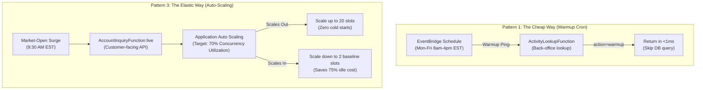

# Core Data Inbound API (`core-data-api`)

[← Back to Platform Architecture](../README.md)

> **Subsystem Scope**: Synchronous high-throughput REST APIs for account inquiries and historical ledger lookups with multi-tiered caching.
> Responsible for sub-10ms customer inquiry responses, provisioned concurrency auto-scaling, and circuit-breaker fallback during upstream exchange outages.

---

## Subsystem Interconnections
- **Upstream Cache Feeder**: Enriched by [`stream-processing-pipeline`](../stream-processing-pipeline/README.md) via the shared `cache.report` DynamoDB table.
- **Outbound Partner Fallback**: Degrades gracefully to [`partner-egress-gateway`](../partner-egress-gateway/README.md) on cache misses.
- **Foundation Resources**: Binds to persistence and encryption primitives provisioned by [`shared-infra`](../shared-infra/README.md).
- **Runtime Layers**: Consumes shared packaging from [`lambda-infra-layer`](../lambda-infra-layer/README.md).

---

## 1. Production Context & Operational Mission

The Core Data API serves institutional trading portals, customer wealth dashboards, and internal clearing desks querying account balances, positions, trading activity, and historical ledger pages.

### The Operational Challenge
- **Market-Open Surges**: At 9:30 AM EST (US market open), API traffic spikes by over 30x in seconds. Cold starts exceeding 500ms cause frontend timeouts and breach client SLAs.
- **Third-Party Exchange Volatility**: External execution venues and market data feeds experience transient outages or high latency (800ms–2,500ms). Customer account inquiry APIs must never lock up or return 500 Internal Server Errors when external partners degrade.
- **Cost Discipline**: Keeping 50 warm containers running 24/7 incurs thousands of dollars in idle AWS compute charges overnight and during market holidays.

---

## 2. Engineering Tradeoffs & Architectural Strategy

### A. The Concurrency Triad: Cost vs. Latency
To balance strict latency SLAs with cost efficiency, the service implements three concurrency profiles across the API surface:



1. **High-Throughput Inquiry Path (`account_service.py`)**:
   - Pinned to the published alias `:live`.
   - Uses `AWS::ApplicationAutoScaling::ScalableTarget` tracking `LambdaProvisionedConcurrencyUtilization` at **70%**.
   - Maintains a floor of **2 slots** (overnight) and scales up to **20 slots** during market hours.
2. **Back-Office Non-Critical Paths (`activity_service.py`, `pages_service.py`)**:
   - Uses scheduled EventBridge pings (`cron(*/5 13-20 ? * MON-FRI *)`) to warm containers during trading hours at zero extra compute cost.
   - Handlers intercept the warmup ping at line 1 and exit in <1ms without touching DynamoDB.

### B. Read-Through Cache with Non-Blocking Egress Fallback
1. **Primary Read Path**: Queries the DynamoDB cache table (`cache.account`) with `ConsistentRead=False` (<8ms latency).
2. **On Cache Miss**: Calls the outbound gateway façade (`partner-egress-gateway`) over an internal connection-pooled HTTP session.
3. **Graceful Degradation**: If the outbound gateway times out or fails, the API gracefully returns cached ledger summaries with a non-blocking diagnostic warning (`outbound_data = {"error": "Outbound enrichment unavailable"}`), preserving customer uptime.

### C. Fire-and-Forget Audit Dispatches
- Auditing account inquiries and activity lookups is strictly asynchronous.
- The handler writes an event to the `InboundLoggingBus` EventBridge bus without blocking the HTTP response thread.

---

## 3. Operational Constraints & SLA Targets

| Metric | Target | Implementation Mechanism |
|---|---|---|
| **P99 Read Latency** | `< 15ms` | DynamoDB single-digit ms point lookups + warm container pools. |
| **P99 Cold-Start Window** | `< 10ms` during market hours | Pre-warmed provisioned concurrency auto-scaled across market open. |
| **Egress Timeout Ceiling** | `2.5s` | Circuit-breaker timeout on outbound exchange fallback. |
| **API Availability SLA** | `99.95%` | Read-through caching isolates customer requests from vendor outages. |
| **Idle Cost Reduction** | `> 70%` | Scale-in cooldown (300s) reduces warm slots during non-trading hours. |

---

## 4. Repository Structure

```
core-data-api/
├── src/
│   ├── account_service.py         # Account inquiry endpoint (Provisioned Concurrency + Auto-scaling)
│   ├── activity_service.py        # Account activity lookup (Trading-hours warmup schedule)
│   ├── pages_service.py           # Historical statement page lookup
│   ├── router_service.py          # HTTP status response builders & routing helpers
│   └── utils.py                   # Parallel DynamoDB cache queries, EventBridge audit dispatches
├── tests/
│   ├── __init__.py                # Local test setup & mock SDK initialization
│   ├── test_account_service.py    # Tests for cache hits, cache misses, vendor degradation, warmup pings
│   ├── test_activity_service.py   # Tests for activity queries, error paths, warmup pings
│   ├── test_pages_service.py      # Tests for pagination lookups and error handling
│   ├── test_router_service.py     # Tests for HTTP response formatting
│   └── test_utils.py              # Tests for parallel cache query execution and audit events
├── template.yaml                  # SAM specification (Regional API Gateway, Auto Scaling, Alarms)
├── build.yaml                     # AWS CodeBuild CI/CD specification
├── diagram.md                     # Concurrency and fallback sequence diagrams
└── readme.md                      # Subsystem documentation
```

---

## 5. Local Verification & Unit Testing

```bash
python -m unittest discover tests -v
```
