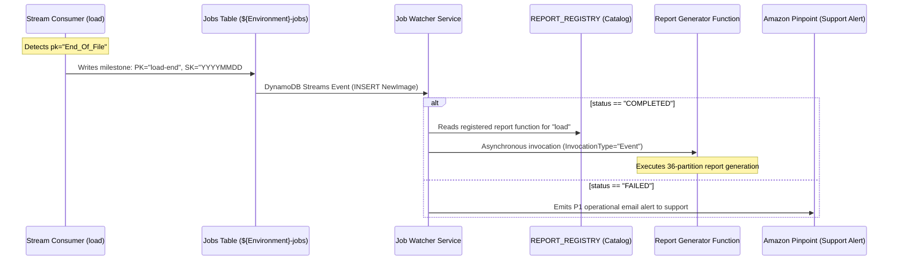

# Job Choreography & State Machine (`job-service`)

[← Back to Platform Architecture](../README.md)

> **Subsystem Scope**: Asynchronous choreographic state machine and milestone monitor coordinating decoupled batch and reporting lifecycles.
> Responsible for asynchronous milestone tracking, zero-cron choreographic workflows, downstream job dispatching, and automated failure alerting.

---

## Subsystem Interconnections
- **Event Producer**: Consumes milestone records (`load-end`, `report-end`) emitted by [`stream-processing-pipeline`](../stream-processing-pipeline/README.md) and [`file-ingestion-pipeline`](../file-ingestion-pipeline/README.md).
- **Asynchronous Target Dispatch**: Invokes downstream reporting lambdas registered via `Custom::ReportRegistrar` dynamically.
- **Foundation Standards**: Implements disaster-recovery compliance and encryption aligned with [`shared-infra`](../shared-infra/README.md).

---

## 1. Production Context & Operational Mission

In multi-stage financial clearing platforms, individual pipeline stages complete at variable times depending on data volume:
- Multi-gigabyte batch feeds take 5–12 minutes.
- CDC stream consumption takes varying durations depending on transaction velocity.

### The Operational Challenge
- **The Fragility of Cron**: Scheduling downstream reporting jobs (daily clearing summaries, trade reconciliation exports) on fixed cron schedules is hazardous. If an upstream load is delayed by network lag, a scheduled report runs against incomplete data, producing incorrect regulatory summaries. If the schedule is pushed too late, settlement deadlines are missed.
- **Direct Synchronous Coupling**: Having an ingestion worker invoke the reporting service directly over synchronous Lambda calls creates fragile runtime coupling and blast-radius escalation across failure domains.

---

## 2. Engineering Tradeoffs & Architectural Strategy

### A. The Milestone Choreography Pattern (`{function_name}-end`)
Instead of cron or synchronous chaining, the platform implements **event-driven choreography** via the central Jobs table:



1. **Upstream Completion**: When `load_consumer_service` detects the terminal `End_Of_File` record in the raw data stream, it writes a milestone record to the Jobs table:
   ```json
   {
     "PK": "load-end",
     "SK": "20261029#233000",
     "function_name": "load",
     "status": "COMPLETED",
     "timestamp": "2026-10-29T23:30:00Z"
   }
   ```
2. **Event-Driven Dispatch**: The `job_watcher` Lambda listens to DynamoDB Streams on the Jobs table:
   - On `status == "COMPLETED"`: Looks up downstream jobs registered in the `REPORT_REGISTRY` item and triggers the report Lambda asynchronously (`InvocationType="Event"`).
   - On `status == "FAILED"`: Emits an immediate P1 alert email to ops via Amazon Pinpoint with subject `ALERT: Job Failed - Review error and retry if safe`.

### B. Automated Dynamic Job Registration (`Custom::ReportRegistrar`)
- Rather than hardcoding job-to-report mappings in Python dictionaries, each downstream service automatically registers its reporting handler in the Jobs table upon CloudFormation deployment using the `Custom::ReportRegistrar` custom resource.
- Enables new reporting jobs to be registered or decommissioned with zero code changes in `job-service`.

---

## 3. Operational Constraints & SLA Targets

| Operational Parameter | Production Target | Design Justification |
|---|---|---|
| **Choreographic Dispatch Latency** | `< 2 seconds` | DynamoDB Streams delivers milestone events to `job_watcher` in near-real-time. |
| **Decoupling Degree** | 100% asynchronous | Upstream ingestion completes immediately upon writing `load-end` without waiting for reports. |
| **Poison-Pill Protection** | Idempotent stream parsing | Stream records are deserialized via `TypeDeserializer` with REMOVE and malformed events safely skipped. |
| **Failure Notification SLA** | `< 30 seconds` | P1 alerts are dispatched via Amazon Pinpoint immediately upon `status == "FAILED"`. |

---

## 4. Repository Structure

```
job-service/
├── src/
│   ├── job_watcher.py             # DynamoDB Streams consumer watching for {stage}-end milestones
│   ├── report_registrar.py        # CloudFormation Custom Resource for dynamic job registration
│   ├── requirements.txt           # Runtime dependencies
│   └── utils.py                   # Pinpoint email delivery, async Lambda invocation, status lookups
├── tests/
│   ├── __init__.py                # Test setup & SDK mocks
│   ├── test_job_watcher.py        # Tests for milestone detection, report triggering, failure alerts
│   ├── test_report_registrar.py   # Tests for catalog create, update, and delete events
│   └── test_utils.py              # Tests for async invocation and Pinpoint dispatches
├── template.yaml                  # SAM infrastructure (Jobs table, Stream EventSourceMapping, IAM)
├── build.yaml                     # AWS CodeBuild CI/CD specification
├── diagram.md                     # Architecture diagrams
└── readme.md                      # Subsystem documentation
```

---

## 5. Local Verification & Unit Testing

```bash
python -m unittest discover tests -v
```
