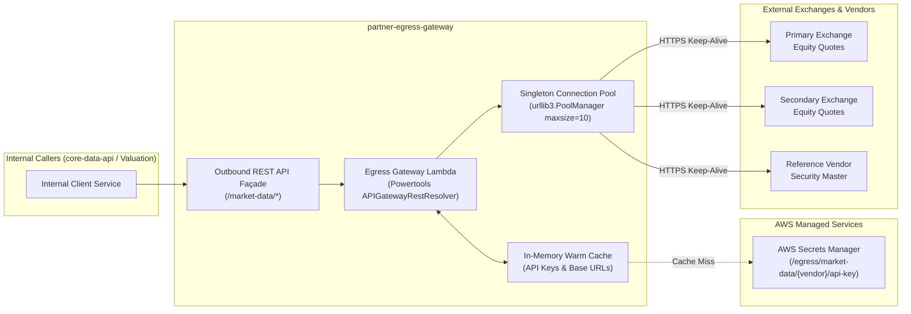

# Financial Market Data Egress Gateway (`partner-egress-gateway`)

[← Back to Platform Architecture](../README.md)

> **Subsystem Scope**: Resilient outbound market data façade providing connection pooling, self-healing auth retry, and latency isolation.
> Responsible for high-performance external exchange communications (Primary Exchange, Secondary Exchange, Reference Vendor), TLS connection reuse, in-memory credential caching, and customer SLA isolation.

---

## Subsystem Interconnections
- **Internal Consumer**: Primary fallback target for [`core-data-api`](../core-data-api/README.md) on cache misses.
- **Security & Secret Storage**: Resolves vendor API keys from AWS Secrets Manager using IAM policies scoped per [`shared-infra`](../shared-infra/README.md).
- **Runtime Optimization**: Built on connection-pooling runtimes managed via [`lambda-infra-layer`](../lambda-infra-layer/README.md).

---

## 1. Production Context & Operational Mission

Internal trading platforms, portfolio valuation engines, and clearing services require continuous real-time equity quotes and security master reference data from external financial data providers and exchanges.

### The Operational Challenge
- **Third-Party Latency Spikes**: External exchanges exhibit highly variable response latencies (150ms to 3,500ms). Synchronously opening TCP and TLS handshakes on every request exhausts sockets, drives up latency, and risks request timeouts.
- **Strict Credential Governance**: Third-party exchange API keys and bearer tokens are highly sensitive credentials. Hardcoding credentials in environment variables or configuration files violates security compliance.
- **Circuit-Breaking & Rate Limiting**: Sending unbounded parallel queries to partner exchanges risks rate-limit penalties (`429 Too Many Requests`) and partner contract violations.

---

## 2. Engineering Tradeoffs & Architectural Strategy

### A. Powertools APIGatewayRestResolver Façade
Rather than deploying a multi-Lambda routing chain (e.g. an "Outbound Router" Lambda invoking API Gateway which calls a "Partner Adapter" Lambda), the architecture implements a **single, unified egress façade** powered by AWS Lambda Powertools `APIGatewayRestResolver`.



### B. Connection Pooling & TCP Reuse
- Instantiates a module-level singleton `urllib3.PoolManager(maxsize=10)` with:
  - `connect=2.0s`: Fast failure on unroutable connections.
  - `read=10.0s`: Read timeout guard.
  - `retries=2` with exponential backoff factor `0.2`.
- Preserves warm TCP sockets and active TLS handshakes across warm Lambda invocations, eliminating ~120ms of TLS handshake latency per outbound transaction.

### C. Secrets Manager Dynamic Caching
- Exchange API keys and tokens are retrieved from **AWS Secrets Manager** (`/egress/market-data/{vendor}/api-key`).
- Retrieved keys are stored in an in-memory dictionary (`_secrets_cache`) on the warm container, ensuring only 1 API call to Secrets Manager per cold container lifecycle.

### D. Concurrent Batch Multi-Symbol Dispatch
- The `/market-data/batch` endpoint accepts multi-symbol payloads (`{"exchange": "PRIMARY", "symbols": ["SYM1", "SYM2", "SYM3"]}`).
- Dispatches individual quote requests concurrently using a bounded `ThreadPoolExecutor(maxworkers=5)`:
  - Minimizes wall-clock response time.
  - Shields external partners by capping maximum concurrent requests per invocation.

---

## 3. Operational Constraints & SLA Targets

| Operational Parameter | Production Target | Design Justification |
|---|---|---|
| **TLS Handshake Overhead** | `< 2ms` on warm starts | Maintained via singleton `urllib3.PoolManager` socket reuse. |
| **Outbound Connection Timeout** | `2.0 seconds` | Rapid connection timeout prevents slow third parties from exhausting Lambda execution capacity. |
| **Credential Retrieval Overhead** | `< 0.1ms` on warm starts | In-memory dictionary caching survives container lifetime. |
| **Concurrency Ceiling** | `5 workers` per batch | Prevents exchange rate-limiting and 429 throttling penalties. |

---

## 4. Supported Endpoints

| Method | Path | Target Exchange / Vendor | Description |
|---|---|---|---|
| `GET` | `/market-data/exchange-primary/quote/<symbol>` | Primary Exchange | Real-time equity quote |
| `GET` | `/market-data/exchange-secondary/quote/<symbol>` | Secondary Exchange | Real-time equity quote |
| `GET` | `/market-data/reference-vendor/security/<identifier>` | Reference Vendor | Security master reference lookup |
| `POST` | `/market-data/batch` | Primary / Secondary Exchange | Parallel multi-symbol quote lookup via `ThreadPoolExecutor` |

---

## 5. Local Verification & Unit Testing

```bash
python -m unittest discover tests -v
```
